### Hi 👋 I'm Dean Hattenhauer

**Backend Developer - Python & Go**
Building automation, AI-driven tools, and backend systems that actually solve problems

- 💻 Resume & background at [deanhattenhauer.dev](https://deanhattenhauer.dev/)
- 🧠 Background in QA and data analysis, now building backend systems in Python and Go
- 🤖 Currently exploring agentic AI workflows and LLM tool integration
- 🛠️ Self-hosted home lab running Linux, Docker, and a full monitoring stack

---

### Featured Projects

- **[Reservation API](https://github.com/deanhattenhauer/reservation-api)** - Full-featured Go REST API with JWT auth, role-based admin actions, conflict detection, CAPTCHA, and async email notifications
- **[Chirpy](https://github.com/deanhattenhauer/chirpy)** - REST API in Go with JWT auth, PostgreSQL, full CRUD
- **[AI Agent](https://github.com/deanhattenhauer/AI-Agent)** - LLM-powered autonomous agent using Google Gemini API
- **[ghost_key](https://github.com/deanhattenhauer/ghost_key)** - Educational password cracking tool (Python, rebuilding in Go)
- **[Static Site Generator](https://github.com/deanhattenhauer/Static-Site-Generator)** - Markdown-to-HTML generator built from scratch

---

### Stack

### Language Usage

---

### Connect

[LinkedIn](https://linkedin.com/in/dean-hattenhauer) · [Resume](https://deanhattenhauer.dev/)
